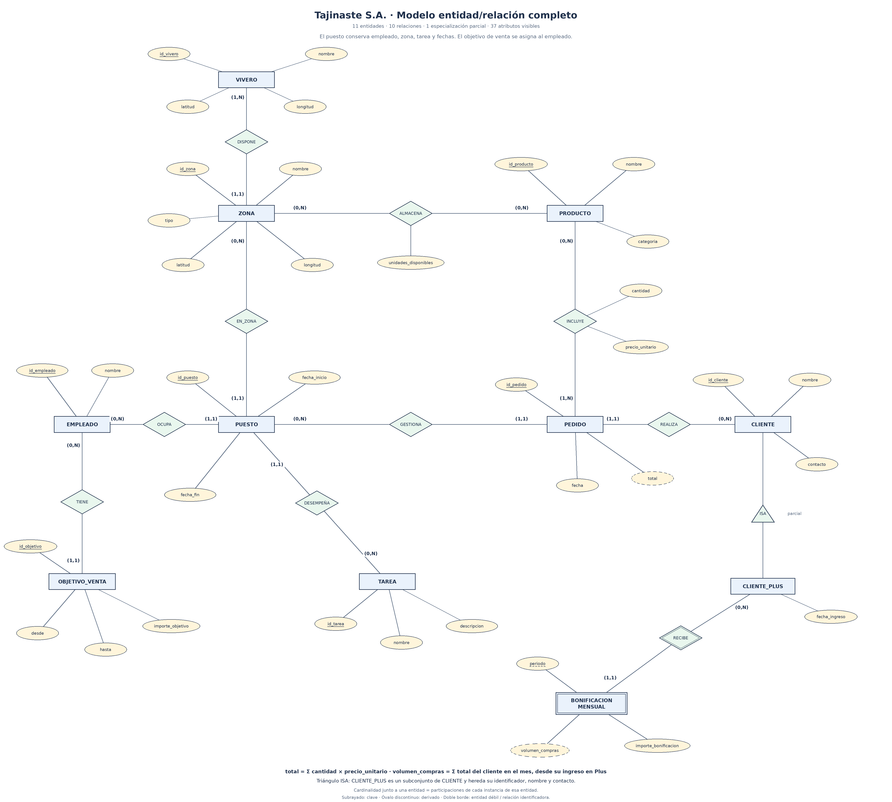
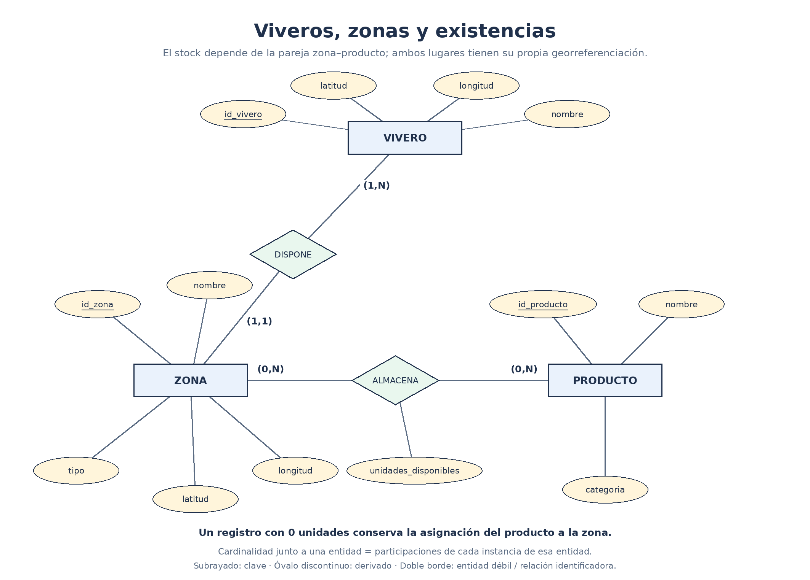
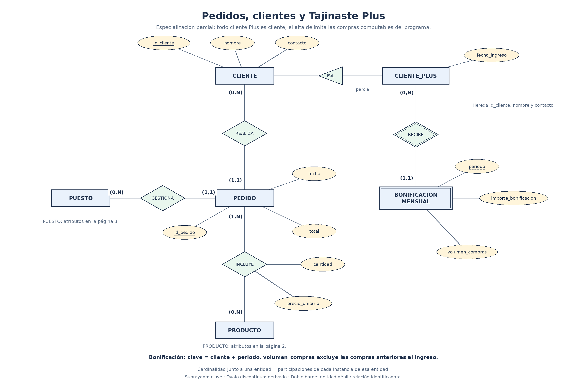
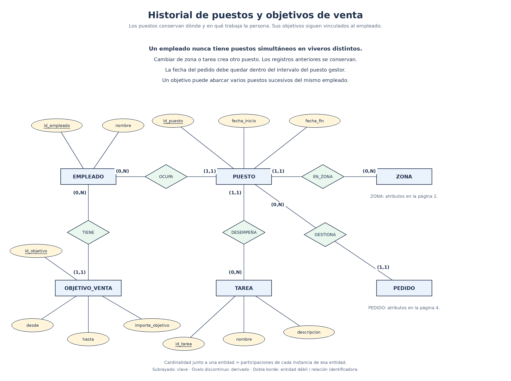
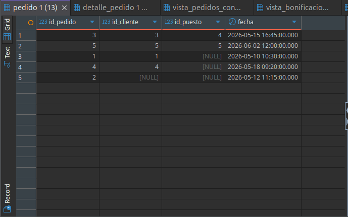
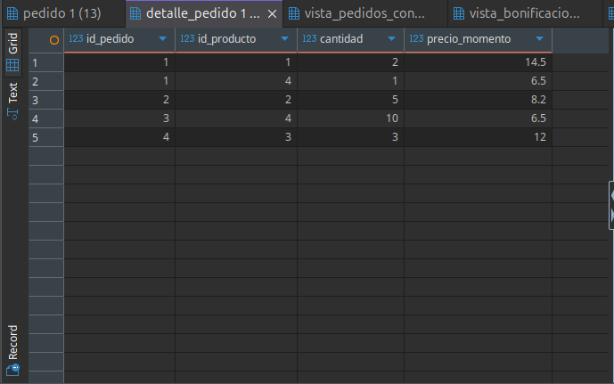
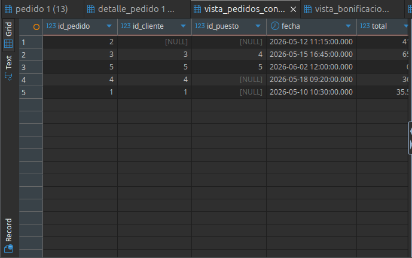
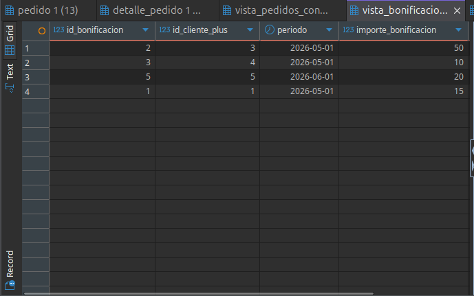
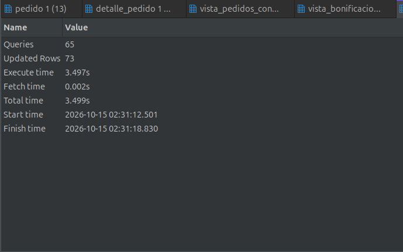

# Practica Base de Datos Viveros - Tajinaste S.A.

Este repositorio contiene la solución completa para el diseño conceptual, modelado lógico e implementación física en PostgreSQL de la base de datos para la empresa de viveros Tajinaste S.A.

---

## Estructura del Repositorio

```text
ADBD-Modelo-relacional-Viveros/
├── ejecucion/
│   ├── 01_dbeaver_conexion.png
│   ├── 02_dbeaver_config.png
│   ├── 03_dbeaver_test_ok.png
│   ├── 04_creacion_base_datos.png
│   ├── 05_ejecucion_script_ddl_dml.png
│   ├── 06_tabla_pedido.png
│   ├── 07_tabla_detalle_pedido.png
│   ├── 08_vista_pedidos_con_total.png
│   ├── 09_vista_bonificaciones_completas.png
│   └── 10_estadisticas_ejecucion.png
├── modelo/
│   ├── historial_productividad.png
│   ├── modelo_viveros.drawio
│   ├── modelo_viveros.png
│   ├── pedidos_fidelizacion.png
│   ├── viveros_stock.png
│   └── Vivero - gráfico del Modelo Relacional.drawio
├── viveros.sql
└── README.md
```

---

## 1. Diseño Conceptual y Lógico

El sistema gestiona la estructura operativa de la cadena de viveros "Tajinaste S.A.", abarcando la infraestructura física, inventario, personal, historial de trabajo, metas comerciales y fidelización de clientes.

### Diagrama Entidad-Relación Completo (E/R)



### Diagramas de Subdominios Específicos

* **Gestion de Viveros, Zonas y Stock:**
  

* **Ventas, Pedidos y Programa de Fidelizacion (Cliente Plus):**
  

* **Asignacion de Puestos, Tareas y Productividad:**
  

### Esquema Relacional Lógico (14 Tablas)

1. **vivero** (id_vivero, nombre, localidad)
2. **zona** (id_zona, id_vivero, nombre, tipo, latitud, longitud)
3. **producto** (id_producto, nombre, precio_unitario, categoria)
4. **almacena** (id_zona, id_producto, stock_en_zona)
5. **empleado** (id_empleado, dni, nombre, telefono, sueldo)
6. **puesto** (id_puesto, id_empleado, id_zona, fecha_inicio, fecha_fin)
7. **tarea** (id_tarea, nombre, descripcion)
8. **puesto_tarea** (id_puesto, id_tarea)
9. **objetivo_venta** (id_objetivo, id_empleado, descripcion, fecha, importe_objetivo)
10. **cliente** (id_cliente, nombre, contacto)
11. **cliente_plus** (id_cliente, fecha_ingreso) *(Herencia ISA de cliente)*
12. **bonificacion_mensual** (id_bonificacion, id_cliente_plus, periodo, importe_bonificacion)
13. **pedido** (id_pedido, id_cliente, id_puesto, fecha)
14. **detalle_pedido** (id_pedido, id_producto, cantidad, precio_momento)

---

## 2. Implementación en PostgreSQL (`viveros.sql`)

El script [`viveros.sql`](./viveros.sql) realiza la creación completa de la base de datos `viveros` con las siguientes características técnicas:

### Reglas de Integridad Referencial y Restricciones (DDL)
* **Claves Primarias y Foráneas:** Definición explícita de PKs y FKs en las 14 tablas.
* **Acciones en Cascada (`ON DELETE CASCADE`):** Aplicado en relaciones de dependencia fuerte como `zona` -> `vivero`, `puesto` -> `empleado`, `cliente_plus` -> `cliente`, y `detalle_pedido` -> `pedido`.
* **Preservación de Histórico (`ON DELETE SET NULL`):** En `pedido`, las referencias a `id_cliente` e `id_puesto` se establecen a `NULL` al eliminar un cliente o puesto, conservando la facturación histórica.
* **Protección Financiera (`ON DELETE RESTRICT`):** Impide borrar productos que ya forman parte de líneas de pedidos facturadas en `detalle_pedido`.
* **Validaciones CHECK:** Restricciones sobre latitud/longitud, precios positivos, stock no negativo y congruencia de fechas (`fecha_fin >= fecha_inicio`).

### Tratamiento de Atributos Derivados (Vistas SQL)
De acuerdo a las reglas de normalización, los atributos derivados no se almacenan estáticamente en las tablas, sino que se calculan mediante vistas dinámicas:
* **`vista_pedidos_con_total`:** Calcula el importe total sumando `cantidad * precio_momento` de cada línea del pedido.
* **`vista_bonificaciones_completas`:** Calcula el volumen de compras acumulado en el mes por los clientes Plus para la liquidación de bonificaciones.

### Datos de Prueba (DML)
* Poblado inicial con un mínimo de 5 filas por tabla abarcando escenarios representativos.
* Sentencias de prueba para verificar borrados en cascada, actualización e integridad referencial.

---

## 3. Configuración y Conexión Remota (DBeaver)

Pasos de verificación de conectividad y despliegue sobre servidor remoto PostgreSQL:

### Configuración de la Conexión JDBC


### Parámetros del Servidor


### Test de Conexión Correcto


### Creación de la Base de Datos `viveros`


---

## 4. Evidencia de Ejecución y Verificación de Datos

### Ejecución Completa del Script SQL (DDL + DML + Vistas)


### Verificación de Tablas Principales
* **Tabla `pedido`:**
  

* **Tabla `detalle_pedido`:**
  

### Consulta de Vistas (Atributos Derivados Calculados)
* **Vista `vista_pedidos_con_total`:**
  

* **Vista `vista_bonificaciones_completas`:**
  

### Estadísticas de Ejecución
